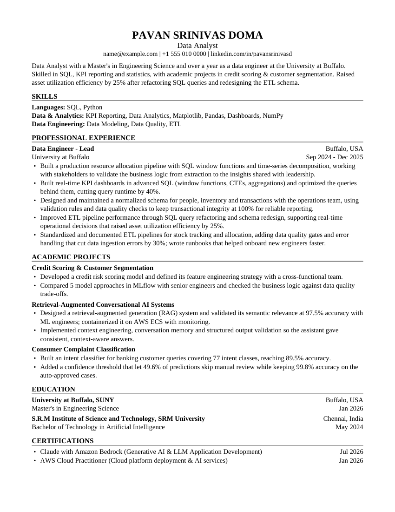

# Example outputs

Generated by `python -m app.cli samples` from the real master resume (with the suggestion pack in
`examples/suggestion-packs/`) against the four synthetic postings in `backend/tests/fixtures/jobs/`.
Email and phone number are masked; nothing else was edited by hand.

| Posting | Job Fit | Resume Alignment | ATS parsing | Evidence integrity | QA | Critical issues | Cycles |
|---|---:|---:|---:|---:|---:|---:|---:|
| [AI Engineer](ai-engineer/resume.pdf) | 67.6 | 70.9 | 100 | 100 | 96 | 0 | 1 |
| [Machine Learning Engineer](ml-engineer/resume.pdf) | 61.0 | 65.3 | 100 | 100 | 96 | 0 | 1 |
| [Data Engineer II](data-engineer/resume.pdf) | 59.8 | 65.6 | 100 | 100 | 97 | 0 | 1 |
| [Data Analyst](data-analyst/resume.pdf) | 66.8 | 71.5 | 100 | 100 | 96 | 0 | 1 |

The scores are this tool's own transparent heuristics (see [`../SCORING.md`](../SCORING.md)), not an
employer's ATS score. Job Fit stays in the 60s on purpose: the candidate has about 1.3 years of
professional experience, and some requirements have no evidence in the profile (Power BI, Tableau and
Excel for the analyst role; Airflow, Snowflake and Kafka for the data engineer role). The platform reports those gaps; it does not paper over them.

## Full report set for the Data Analyst posting

| File | Contents |
|---|---|
| [`resume.pdf`](data-analyst/resume.pdf), [`resume.docx`](data-analyst/resume.docx) | the tailored resume |
| [`match_report.md`](data-analyst/match_report.md) | Job Fit and Resume Alignment breakdowns, gates, evidence per requirement |
| [`missing_skills.md`](data-analyst/missing_skills.md) | requirements without evidence, and listed skills that no bullet demonstrates yet |
| [`change_log.md`](data-analyst/change_log.md) | every change from the master resume, with the reason and its evidence |
| [`evidence_integrity.md`](data-analyst/evidence_integrity.md) | each claim on the resume traced to its source |
| [`evaluation_report.md`](data-analyst/evaluation_report.md) | everything above plus ATS parse-back per extractor, QA issues and the revision cycles |

Things to notice:

- The posting's exact title sits under the name; the professional title (Data Engineer - Lead) is unchanged.
- The summary names the posting's top evidenced skills and one real number; no adjectives about the
  candidate.
- Skills follow the posting's priorities. Data engineering skills appear because the candidate has
  evidence for them and the section was otherwise thin; GenAI and cloud skills are left out for this role.
- The AI Engineer version puts the academic projects first because they are the strongest evidence for
  that role; the Data Analyst version keeps professional experience first.
- No bullet claims anything the master resume does not. Words like "production-scale" and "enterprise"
  were removed from an academic project until the candidate confirms it served real users.
